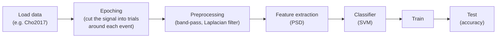

# bci_lib

**A small Python library for building modular EEG / brain-computer-interface pipelines on top of MNE and scikit-learn.**

[](https://pypi.org/project/bci-lib/)

[](LICENSE)


A BCI workflow (load, preprocess, extract features, classify, evaluate) is written as a sequence of stages that wrap [MNE-Python](https://mne.tools) and [scikit-learn](https://scikit-learn.org). Alpha research prototype (v0.0.9, 2020); install with `pip install bci_lib` on Python 3.6–3.8.

## How it works

Each stage is added to the pipeline in order with `add_stage`; the library wires each stage's output to the next stage's input and, after a train/test split, runs later stages on both train and test data.



```python
import bci_lib as bl

bl.Dataset.change_BASE_LOCAL_LOCATION('./data/')    # cache dir: must exist, end with '/'

pipeline = bl.SingleRun()

load = pipeline.add_stage(bl.Stages.LoadData.LoadFromDataset)          # Cho2017, subject 1
load.set_params(bl.Dataset.Cho2017.s01)

epoch = pipeline.add_stage(bl.Stages.Preprocess.RawDataToEpochsData)   # events on 'Stim'
epoch.set_params()                                                      # tmin=-0.1, tmax=0.3

band = pipeline.add_stage(bl.Stages.Preprocess.BandPassFilter)         # 3-30 Hz
band.set_params(3, 30)

split = pipeline.add_stage(bl.Stages.Preprocess.TestTrainSplit)        # 80/20
split.set_params(test_size=0.2, random_state=1)

psd = pipeline.add_stage(bl.Stages.FeatureExtraction.PSD)              # band power, EEG only
psd.set_params([(3, 8), (12, 16)], picks='eeg')

model = pipeline.add_stage(bl.Stages.Classification.CreateModel)       # SVM
model.set_params(bl.Stages.Classification.MLModel.SVM.SVC)

train = pipeline.add_stage(bl.Stages.Classification.Train)
train.set_params()                                                      # sklearn SVC defaults

test = pipeline.add_stage(bl.Stages.Classification.Test)
test.set_params('accuracy')

pipeline.do_task()
```

This example shows how a pipeline is built, using a single subject. The parameters are not tuned and the accuracy is not a reported result.

## License

MIT, see [LICENSE](LICENSE).

## Authors

- **Sahand Sadeghpour** (maintainer) · <sahand.2k.ss@gmail.com> · <https://github.com/SahandSadeghpour/bci_lib>
- Mehrshad Hosseini
- Andy Partovi
- Farhad Goodarzy
- Reyhaneh Pahlevan
- Amir Kabiri
- Soroush Ziaee
- Kiana Liaghat
- Erfan Habibi Panah Fard
